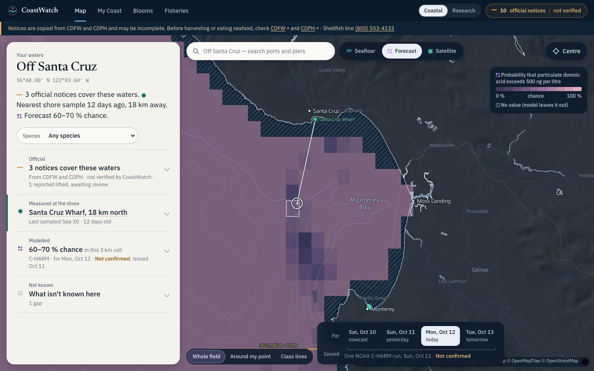

# CoastWatch signature experience: design studies and prototypes

These are isolated design work for CoastWatch's visual identity, motion, loading and mobile UX. **They are not part of the production app.** Nothing under `coastwatch-web/` was changed, and nothing was deployed.

**The idea:** CoastWatch's distinctiveness comes from its purpose, which is showing the difference between what is **official**, **measured**, **modelled** and **not known**. Each kind of knowing gets its own graphic mark:
- a **line** for an official rule;
- a **point** for a sample;
- a **field** of exact cells for a model;
- **hatching** for a gap.

The same mark appears on the map, in sentences and in charts. Selecting any point on the water draws **provenance threads** to where each statement actually comes from.



## Read in this order

1. [Design audit](01-design-audit.md): what the redesign gets right, and 12 prioritised design findings.
2. [Three directions and the recommendation](02-directions.md): Observatory, Living Coast and Atlas, combined as "Atlas reading, Observatory instrument".
3. [Design language](03-design-language.md): colour, type, layout and motion tokens.
4. [Interaction specifications](04-interactions.md): 12 interactions with guardrails and integration status.
5. [Evaluation](05-evaluation.md): three critique passes, accessibility and performance results.
6. [**Handoff**](06-handoff.md): ranked roadmap, component map, and the animation patterns that would mislead.
7. [Library research](research/02-library-research.md).

## Run the prototypes

```bash
cd design/signature/prototypes
npm install
npm run snapshot   # copies a pinned snapshot of the real published data (read-only from coastwatch-data)
npm run dev        # http://127.0.0.1:3460
```

**Start at `#/`.** It links to every prototype and every reproducible state. A few to try:

- **First visit:** `#/explorer`
- **A water point with threads:** `#/explorer?at=-122.06,36.80&show=forecast&welcome=0`
- **Nearshore gap explained:** `#/explorer?at=-121.93,36.62&show=forecast&welcome=0`
- **Station season story:** `#/station`
- **Loading and failure:**
  - `#/states`
  - `#/explorer?at=-122.06,36.80&show=forecast&net=3g&welcome=0`
  - `…&fail=charm,tiles`
- **Three directions:** `#/directions`
- **Design language:** `#/system`

**Checks:**
- `npm run build && npm run preview` (port 3461), then `node scripts/audit.mjs out.json`
- `GPU=1 node scripts/perf.mjs`
- `node scripts/shots.mjs <dir> name=route@WxH`

## Screenshots

**Desktop:**
- [first visit](img/d1-map-first-1440.jpg)
- [selected point](img/d2-map-selected-veil-1440.jpg)
- [lens](img/d3-map-lens-1440.jpg)
- [class lines](img/d4-map-class-lines-1280.jpg)
- [nearshore gap](img/d5-map-nearshore-gap-1440.jpg)
- [satellite](img/d6-map-satellite-1440.jpg)
- [research](img/d7-map-research-1440.jpg)
- [tablet](img/d8-map-tablet-1024.jpg)
- [forecast and tiles failed](img/d9-map-failure-1440.jpg)
- [station](img/s1-station-1440.jpg)
- [states](img/x1-states-1440.jpg)
- [system](img/x2-system-1440.jpg)
- directions: [desktop](img/directions-desktop.jpg), [mobile](img/directions-mobile.jpg)

**Phone:**
- [first visit](img/m1-map-first-390.jpg)
- [peek](img/m2-map-peek-390.jpg)
- [half](img/m3-map-half-390.jpg)
- [320 px](img/m4-map-320.jpg)
- [station](img/s2-station-390.jpg)

## Data and honesty

- Real data from the published CoastWatch dataset (`coastwatch-data@0353c1f3`, 13 Oct 2026 00:42 UTC), on a fixed clock of 12 Oct 2026, 6 PM PDT.
- One labelled fixture: the CDPH SN26-021 discrepancy, in PR #40's format. It is shown as disputed and never as lifted.
- No stakeholder testing was done. Scores and first-screen checks are heuristic.
