# Neritic Chart: component reference

The library in `coastwatch-web/src/nx/ds/` (import from `@/nx/ds`). The spec is [README.md](README.md); where
they disagree, the spec wins. The living catalog is the route `/system` (`?mode=day|dusk|night`, not
indexed); every image below is a screenshot of it, in `catalog/`, at 1440 px in Day unless named
otherwise (each also exists as `-dusk-`, `-night-` and at `-390`). Whole pages: `catalog/system-day-1440.png`,
`system-dusk-1440.png`, `system-night-1440.png`. Open states: `provenance-open-*`, `dialog-open-*`, and on phone
`sheet-open-*` and `sheet-up-*`. Screenshots are 256-colour PNGs from a production build on fixture data.

## Rules every component follows

- **Tokens only.** Colour, type size, space, rule and radius come from `tokens.css`; `npm run lint:design`
  fails on anything else (spec section 3). CSS lives beside each component as a CSS module.
- **Three chart modes.** Wrap a page (or the app) in `ChartModeRoot mode=…`; every component reads the mode's
  token table. Overlays portal back into that scope, so dialogs and sheets keep the mode. `resolveChartMode`
  and `CHART_MODE_SCRIPT` give Day by default, Dusk from `prefers-color-scheme: dark`, Night only by choice.
- **Motion only through `ds/motion`.** `ChartModeRoot` sets Motion's `reducedMotion="user"`; components that
  draw (series ink, loading line) shorten to nothing under reduced motion. Data frames cut (T26).
- **Words, not icons.** Verification is the words "not verified"; states are sentences; an icon never
  stands alone unless the control is universal and has an `aria-label`.
- **Targets.** Every control is at least 48 px on its touch axis; inline controls (stamps, text links) get an
  invisible 48 px hit area that does not move the line.
- **Dates and figures.** Components take ISO dates and format them (`ds/format`: Pacific time, absolute,
  "Dec 15–18"); figures arrive at their honest precision (`sig`, T15).
- **Tokens added for the library** (no existing value changed): the font stacks re-declared on every
  `[data-chart-mode]` scope so they resolve wherever the font variables sit, `--focus` (ink, per mode) and
  `--halo-w` (3 px knockout halo).
- **Fonts.** `ds/fonts.ts` exports `literata`, `publicSans` and `fontVariables` (`--nx-literata`,
  `--nx-public-sans`); put `fontVariables` on `<html>`. Import `ds/tokens.css` once at the root.

Shared states (spec section 9): each component lists the states it has. Hover, focus and pressed are
universal: hover underlines (1.5 px) or inverts a ruled control to ink; focus is a 2 px ink outline at 2 px
offset; pressed is the `press` preset (scale 0.97, 0.12 s).

---

## Foundations

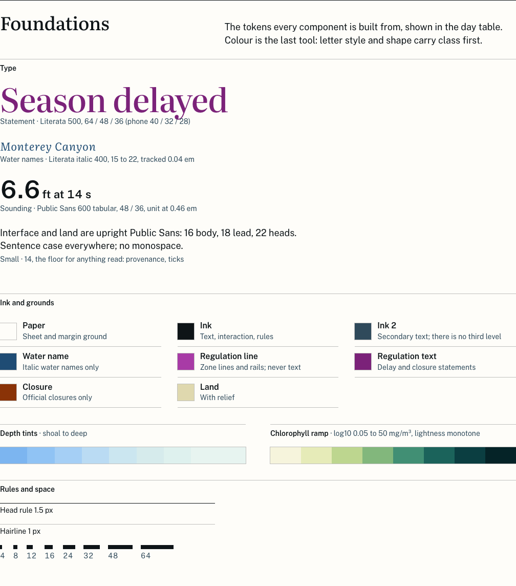

Type, ink and grounds, depth tints, the chlorophyll ramp, rules and the space scale, shown live in the current
mode. Use it to check a mode's table at a glance.

## Statement

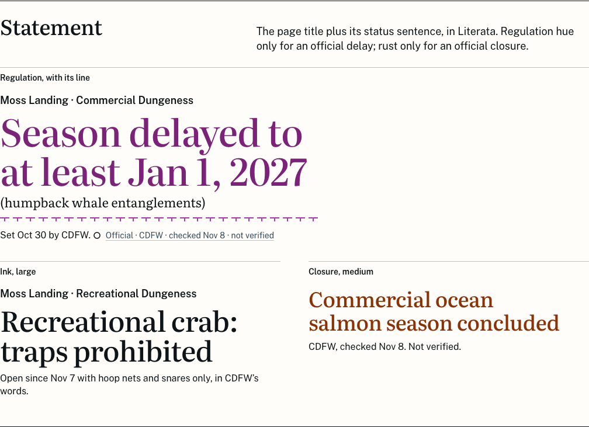

- **Purpose.** The page title plus its status sentence, in Literata 500.
- **Use** for a page's first statement (Today's season status, My Coast's "Plan a trip from Moss Landing").
- **Don't use** for section heads inside the margin (22 px Literata is enough) or for figures (use a Sounding).
- **Props.** `title`, `size` `xl | lg | md` (64/48/36, phone 40/32/28), `tone` `ink | regulation | closure`,
  `as` `h1 | h2 | h3 | p`, `scope` (the port and fishery line above), `why` (serif reason line), `rule` (the
  T-dash regulation line, regulation tone only), `children` (status sentences and the stamp).
- **States.** Ink; regulation (magenta, only for an official delay); closure (rust, only for an official
  closure). Balanced wrapping; width capped in ems so the statement keeps its shape.
- **Motion.** None of its own; a shell may give the title a `layoutId` (spec section 8, `layout`).
- **Accessibility.** Renders a real heading; tone is never the only carrier of meaning (the words say
  "delayed", "concluded").

## BigDate

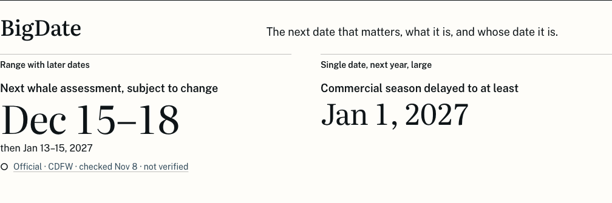

- **Purpose.** The next date that matters, with what it is and whose date it is.
- **Use** once per view, for the decision date (RAMP assessment, opening date).
- **Don't use** for past dates or for a list of dates (use Agenda).
- **Props.** `label`, `start`, `end?`, `then?: DateSpan[]`, `now` (a year prints only when it differs),
  `size` `xl | lg`, `children` (the Stamp).
- **States.** Single date, range, range with later dates, next-year date.
- **Accessibility.** The date is a `<time dateTime>`; "subject to change" belongs in the label, in words.

## Agenda

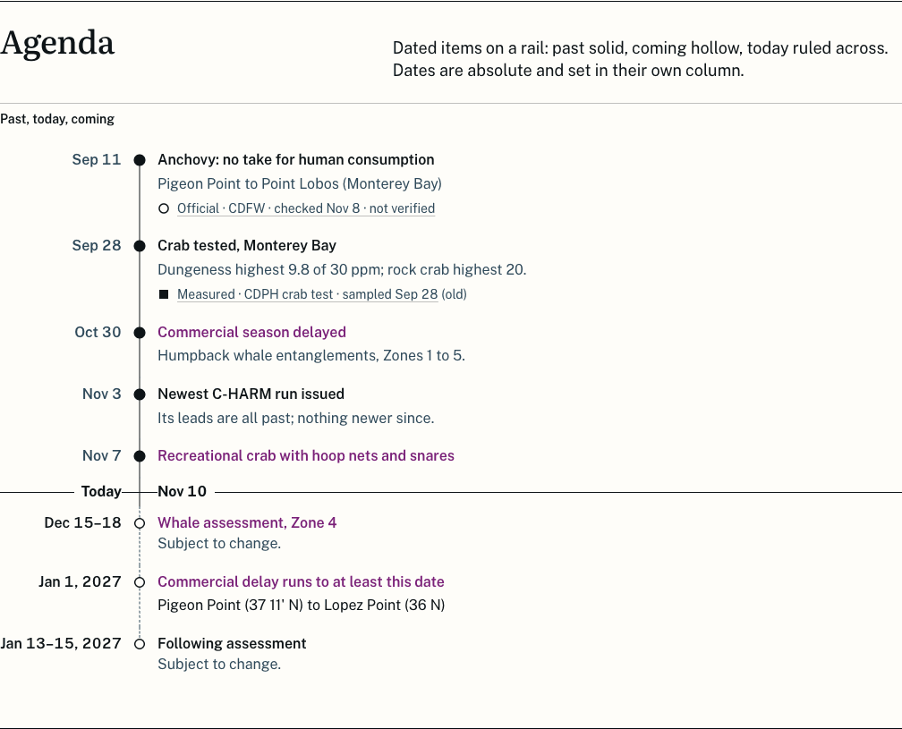

- **Purpose.** Dated items on a rail (from the Tide concept): past solid, coming hollow, today ruled across.
- **Use** for what happened and what is next at a port (notices, tests, assessments).
- **Don't use** for continuous time series (SeriesChart) or for more than about ten items.
- **Props.** `items: AgendaItem[]` (`id`, `start`, `end?`, `title`, `detail?`, `tone?`, `tentative?`,
  `stamp?`), `now`, `label`. `agendaPhase(item, now)` is exported.
- **States.** Past, under way (today inside the item: an item with its own date and a solid dot, never the now
  line's rule; the now line above it then prints only "Today"), coming; tentative ("Subject to change.");
  regulation tone on the title only. Dates wrap inside their column when a year is printed.
- **Accessibility.** An ordered list with an accessible name; each item is prefixed for screen readers with
  "Past.", "Under way." or "Coming."; the now line is a list item named "Today, Nov 10".

## Mark and Legend

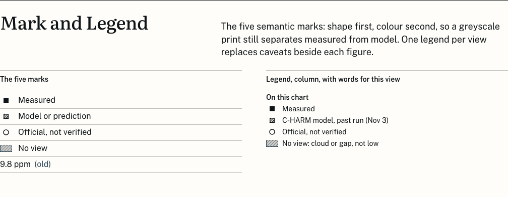

- **Purpose.** The five semantic marks (measured solid, model hatched, official ring with words, no view
  hatch, stale "(old)") and one legend per view.
- **Use** beside any reading whose kind is not otherwise shown; one Legend per view instead of a caveat per
  figure.
- **Don't use** colour alone, or a mark without the legend somewhere in the view.
- **Props.** `Mark`: `kind` (`measured | model | official | noview | stale`), `withWords` (official only; turn
  off only when the same line already says "not verified"). `Legend`: `kinds`, `words?` (per-view words),
  `title?`, `layout` `row | column`. `markFor(kind)` maps T1 kind words to marks.
- **Accessibility.** Measured, model and no view are named images; official carries the words; stale is
  text. Shapes survive greyscale (T2).

## Stamp and ProvenanceSheet

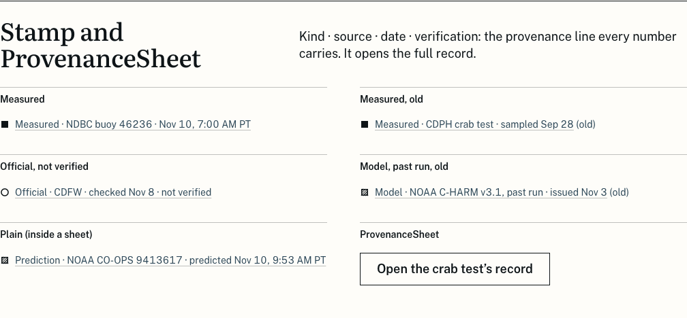

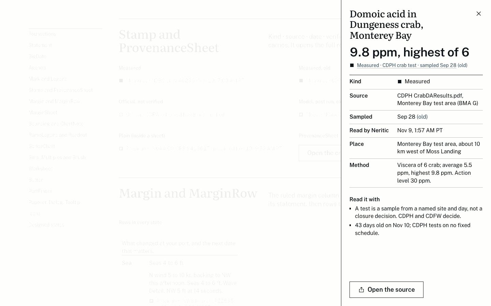

- **Purpose.** Kind · source · date · verification, the provenance line every number carries (T1); it opens
  the full record.
- **Use** under or beside every reading, in the margin and in readouts.
- **Don't use** the sheet for long explanations; caveats are short lines.
- **Props.** `Stamp`: `provenance: Provenance`, `now?`, `interactive` (false inside a sheet). `Provenance`:
  `kind`, `title`, `value?`, `source`, `sourceLong?`, `sourceUrl?`, `date`, `dateRole?` (`measured | issued |
  sampled | checked | assessed | valid | predicted | set`; `assessed` is an agency's own assessment date, as
  CDFW's RAMP risk assessments: "assessed Nov 6"), `retrieved?`,
  `place?`, `resolution?`, `method?`, `caveats?`, `stale?`. `ProvenanceSheet`: `provenance`, `open`,
  `onOpenChange`, `trigger?`. `stampText()` gives the line as a string.
- **States.** Measured, model, official (always "not verified", T38), old ("(old)" beside it, T17), plain.
- **Motion.** The sheet enters with `sheet` (from the right on desktop, from below on phone).
- **Accessibility.** The stamp is a button with the whole line as its name plus "Open where this comes
  from"; the sheet is a Radix dialog (focus trapped and returned, Escape closes) with a definition list.

## Margin and MarginRow

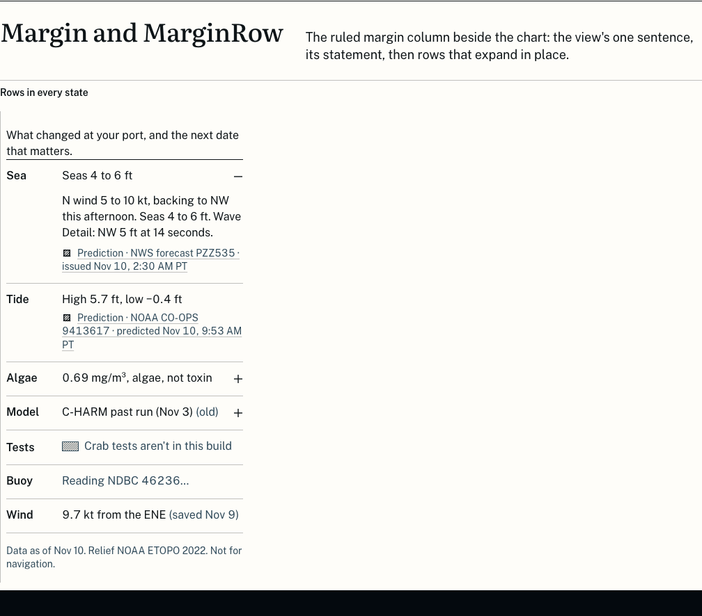

- **Purpose.** The ruled margin column beside the chart: the view's one sentence, its statement, rows that
  expand in place, and the imprint.
- **Use** for every page's margin on desktop; on phone the same rows go into a MarginSheet.
- **Don't use** boxed panels, cards or row-plus-chevron lists.
- **Props.** `Margin`: `label`, `imprint?`, `children`. `MarginRows`: `label?`. `MarginRow`: `label`,
  `value?`, `detail?` (expands), `stamp?`, `state` (`default | stale | unavailable | loading | offline`),
  `note?`, `defaultOpen?`.
- **States.** Default, expandable (+/−), expanded, stale, unavailable (no-view hatch and the reason),
  loading (worded, live region), offline (with the save date).
- **Motion.** The detail opens with `settle`; the plus turns to minus with the same spring.
- **Accessibility.** The column is a complementary landmark; rows are a list; the toggle is a button with
  `aria-expanded` and `aria-controls`.

## MarginSheet

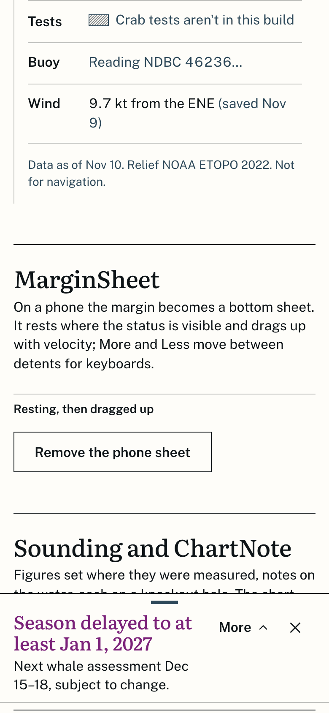 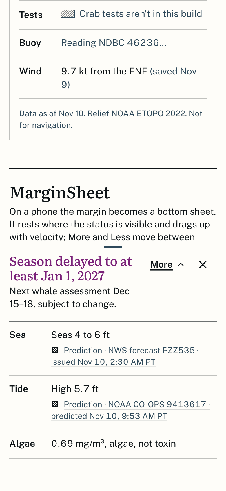

- **Purpose.** The phone margin: a bottom sheet that rests where the status is visible and drags up with
  velocity to the nearest detent. It is not a dialog: the page and the chart stay live and reachable around it.
- **Use** on phone layouts only, for the page's margin (the shell mounts it for every page), or for a transient
  readout (with `onClose`).
- **Don't use** on desktop, or for confirmations (use Dialog).
- **Props.** `label`, `peek?` (shown at rest; without it the page's own first lines rest in view and More sits in
  the handle row), `children`, `detents` (default `176px`, `0.55`, `0.94`), `detent?`/`onDetentChange?`
  (controlled; the shell's `openMargin("rest" | "half" | "full")` drives it, e.g. Explore when a reading
  arrives), `bottomInset?` (the tab bar over its lowest part), `inline?` (no portal), `scroll?` (`reading`, or
  `always` so a page can scroll a new part into view below reading height), `onClose?`.
- **States.** Resting, half, reading height; the body scrolls at reading height (or always).
- **Motion.** Motion's drag from the handle row; release flings to the nearest detent with the `sheet` spring
  (stiffness 380, damping 36); More and Less use the same spring; reduced motion jumps. The first frame is
  drawn at the resting detent. (vaul was dropped: 1.1.2 always opens a modal Radix dialog, hiding the page
  from assistive tech and trapping focus.)
- **Accessibility.** A labelled region, never modal; "More"/"Less" moves between detents for keyboard and
  switch users; the chart stays operable above it.

## Sounding

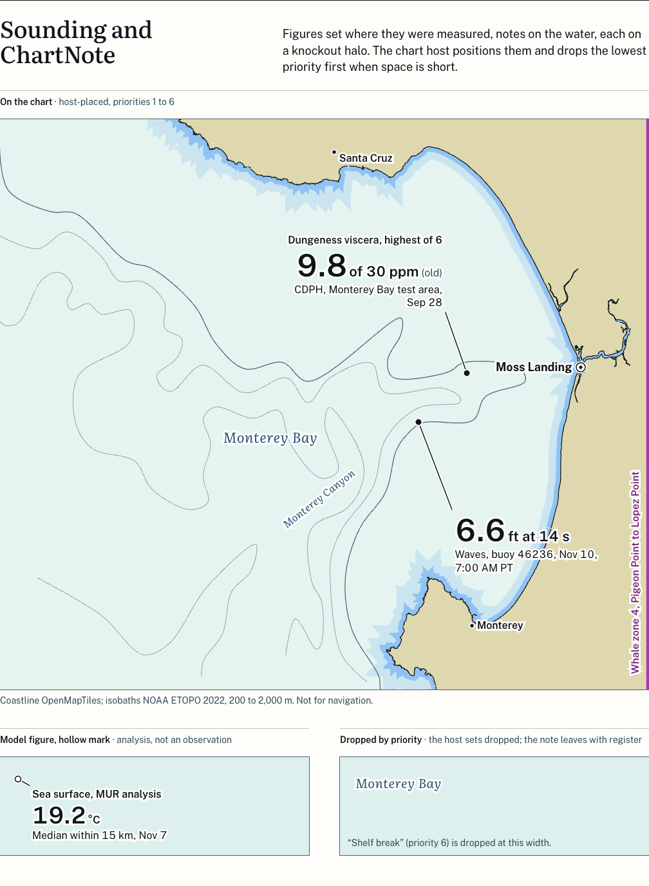

- **Purpose.** A figure set where it was measured, with unit, kind mark and a leader line (principle 2).
- **Use** for at most two or three readings on a view; the rest go in the margin.
- **Don't use** for anything without a place, or for a number already shown elsewhere on the screen.
- **Props.** `x`, `y` (screen px from the chart host), `value` (already at honest precision), `unit?`,
  `label?`, `caption?` (kind, source, date), `kind`, `anchor` (`ne nw se sw e w n s`), `leader` (`{dx, dy}`
  or null), `priority`, `dropped`, `halo`, `size` `lg | md`, `stale?`, `onActivate?`, `ariaLabel?`, `width?`
  (the most the type may take), `placement` `point | box`. `box` sets the type in normal flow at its own size
  with no leader or point, for the chart's marks layer (`ChartMarks`), which measures the box, places it and
  draws the leader and point itself.
- **States.** Measured (solid dot), model (hollow dot), official (ring), old, interactive (button, focus
  ring), dropped (leaves with `register`). Phone sizes 36/28.
- **Motion.** Appears with `register` (0.24 s, from 0.96).
- **Accessibility.** With `onActivate` it is a button; give `ariaLabel` the full spoken reading.
  Positioning and collisions belong to the chart host.

## ChartNote

- **Purpose.** A short note on the water, on a knockout halo, by letter style: water names italic serif,
  places upright sans, a port with its circled dot, regulation in magenta.
- **Use** for names and short notes the chart needs; drop by priority when space is short.
- **Don't use** for readings (Sounding) or for sentences longer than a line or two.
- **Props.** `x`, `y`, `children`, `variant` (`water | place | port | note | regulation`), `anchor`, `rotate`,
  `size` (water names 15 to 22), `priority`, `dropped`, `halo`, `width?`.
- **States.** Each variant; rotated along a feature; dropped.
- **Motion.** `register` in and out.

## RampLegend

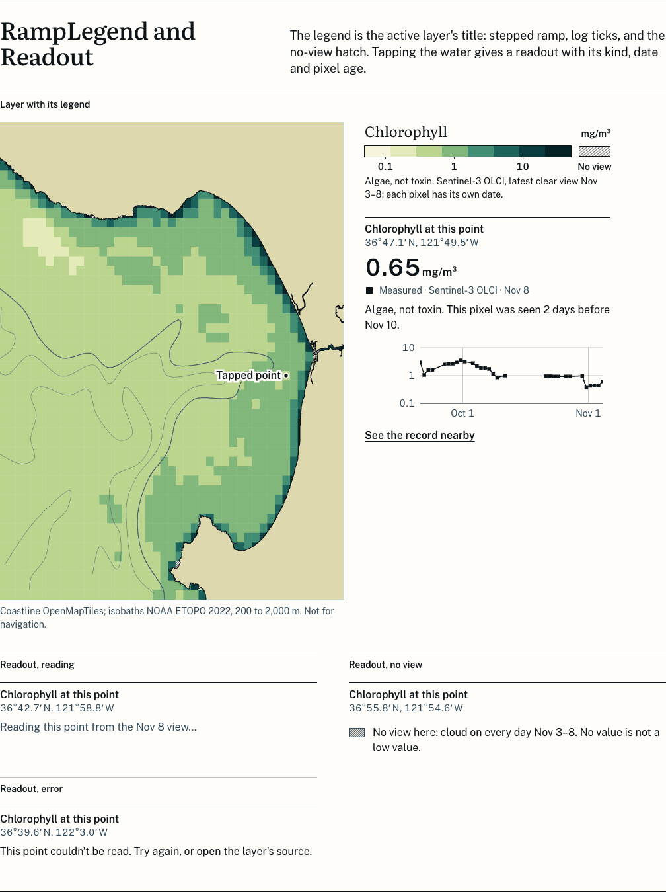

- **Purpose.** Legend-as-title for the active layer: stepped ramp, log ticks, the "no view" hatch, and the
  caption with the mandatory words.
- **Use** once per data layer, at the top of Explore's margin.
- **Don't use** a continuous gradient or a ramp without "no view" (T19, T21).
- **Props.** `title`, `unit`, `steps` (token names), `domain`, `scale` `log | linear`, `ticks`, `tickFormat?`,
  `caption?`, `noView`, `opacity` (drawn as the data is drawn, T23). `rampPosition()` is exported.
- **Accessibility.** A figure named with the layer, unit, range and scale.

## Readout

- **Purpose.** The result of tapping the water: value, kind, date, pixel age, a linked chart and the next
  step.
- **Props.** `title`, `lat`, `lon`, `state` (`value | loading | noview | error`), `value?`, `unit?`,
  `provenance?`, `now?`, `note?`, `children` (the linked SeriesChart), `action?`, `message?`, `onClose?`.
- **States.** Value; reading (worded); no view ("No value is not a low value"); error (what to do).
- **Motion.** Enters with `sheet`.
- **Accessibility.** A named region, polite live updates, a 48 px close control.

## SeriesChart

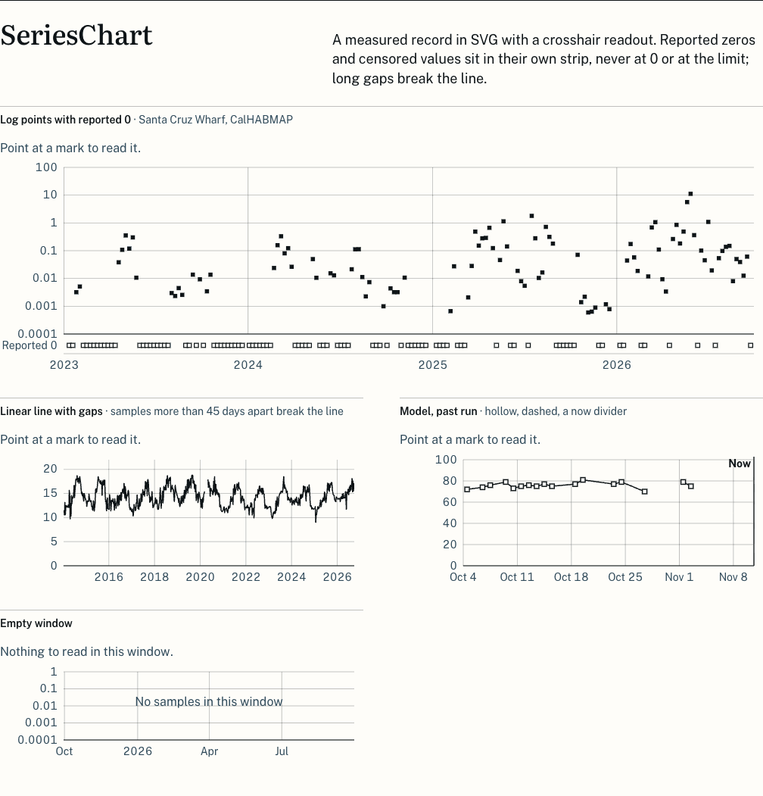

- **Purpose.** A record in SVG (d3-scale, d3-shape) with a crosshair readout.
- **Use** for station records, model histories, transects.
- **Don't use** to put a water-sample scale next to a seafood scale (T6), or to tween between frames.
- **Props.** `points: SeriesPoint[]` (`t`, `v`, `raw?`, `flag?` `reported0 | censored | nd`), `label`,
  `unit`, `kind`, `scale` `log | linear`, `yDomain?`, `xDomain?`, `height`, `marks` `points | line | both`,
  `gapDays`, `threshold?`, `now?`, `censoredLabel?`, `hoverT?`/`onHoverT?` (shared crosshair),
  `showReadout`, `xAxis`, `title?`, `inkIn`.
- **States.** Points, line with gaps (runs break at censored samples and at long gaps), model (hollow marks,
  dashed line, now divider), censored strip ("Reported 0", "Below limit"), empty window (worded), hovered.
- **Motion.** The line inks in once with `ink`; later window changes cut.
- **Accessibility.** The plot is a focusable group: arrow keys, Home and End read one sample at a time
  into a polite live line; a hidden sentence states the count, span and censored count.

## SmallMultiples and Brush

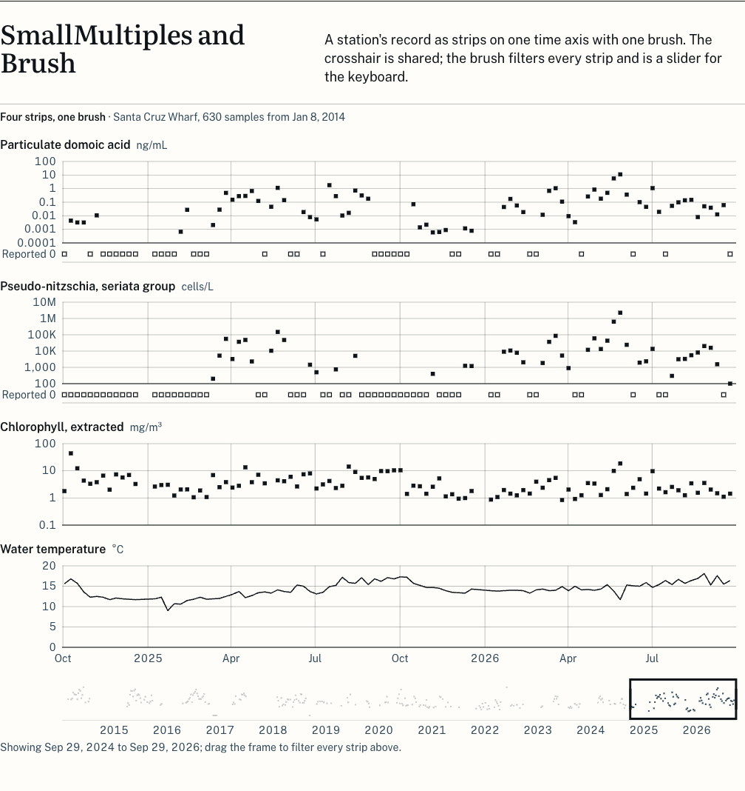

- **Purpose.** A station's record as strips on one time axis with one brush; the crosshair is shared.
- **Props.** `SmallMultiples`: `strips: Strip[]`, `overview?`, `initial?`, `value?` (the window, controlled by
  the page: URL state, presets, export), `onWindow?`, `label?`, `stripHeight?`. Points may carry `low` (a model
  value from too few cells: an open circle, never joined, read as "from few model cells"). Short strips keep
  every grid line and label only the ticks that fit (`labelledTicks`). `Brush`: `extent`, `value`, `onChange`, `points?`, `scale?`, `height?`,
  `minDays?`, `label`. `clampWindow()` is exported.
- **States.** Default window (last two to three years), dragged, resized, at either end.
- **Research keeps its own strips.** `src/nx/research/RecordStrips.tsx` draws a station's record as one SVG
  stack, which the library's per-strip `SeriesChart`s cannot be without becoming a second component: the stack
  exports as a single figure (the SVG export), strips with nothing in the window fold to their header line,
  every strip carries its own reported-0 and rejected lanes, the model strip hatches the span before any
  history was kept, and plot height is solved to fill the record panel. What generalises was promoted here
  (the controlled window, tick thinning, the shared crosshair, the low-cell model mark); the rest is the
  record's own layout and stays with Research.
- **Accessibility.** The window and both edges are sliders (arrows a month, Shift a year, Home, End) with
  date value text; a caption states the window in words.

## Worksheet: Field, Stepper, Segmented, Toggle, Waterfall, SensitivityTable

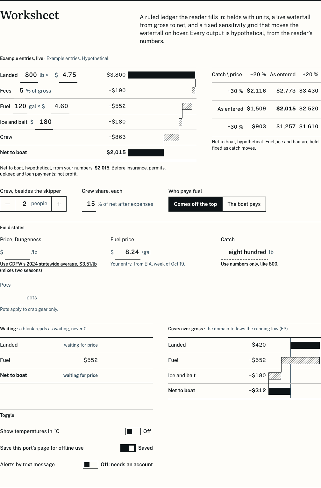

- **Purpose.** A ruled ledger the reader fills in: inputs with units, a live waterfall from gross to net,
  and the fixed ±20/30 % grid (T45).
- **Use** on My Coast only, with every output labelled "hypothetical, from your numbers".
- **Don't use** pre-filled numbers (T47) or anything computed from chlorophyll, models or sea state (T46).
- **Props.**
  - `Field`: `label`, `value`, `onChange`, `prefix?`, `suffix?`, `inputMode`, `reference?` (a sourced
    value entered only on a tap), `fromReference?`, `hint?`, `error?`, `disabled?`, `size`, `layout`
    `stacked | inline`, `hideLabel?`.
  - `Stepper`: `label`, `value`, `onChange`, `min`, `max`, `step`, `unit?`, `disabled?`.
  - `Segmented`: `label`, `options`, `value` (may be null: nothing assumed, E2), `onChange`.
  - `Toggle`: `label`, `checked`, `onChange`, `onWord`, `offWord`, `disabled?`.
  - `Waterfall`: `steps: WaterfallStep[]` (`gross | cost | net`, `amount` or null with `waiting` words),
    `cells?` (inputs in the label column), `label`, `domain?` (a money scale held from outside, so scenario
    previews move against one axis; clamped), `testIdPrefix?`. `layoutWaterfall()` is the DOM-free layout
    (E3: without `domain` the scale follows the running minimum). Figures settle (`SettlingMoney`); a blank
    row says what it waits for across figure and bar.
  - `SensitivityTable`: `rows`, `cols`, `value(rf, cf)`, `selected`, `onSelect`, `corner`, `caption`
    (state what is held fixed, E4). Mouse and pen preview on hover and return on leaving; a touch counts only
    its click (a tap shows a scenario, a second tap on it returns), so the enter, leave, click a touch sends
    never shows and clears a scenario at once.
- **States.** Empty with a reference, from a reference, error (words, dashed rule), disabled (dotted rule,
  reason); waiting ("waiting for price", never 0); costs over gross; scenario previewed from the grid.
- **Motion.** Bars and connectors move with `settle` springs when a figure or scenario changes; the toggle
  knob with `settle`; every control presses.
- **Accessibility.** Labels on every input (visually hidden in ledger lines); the stepper is a spinbutton
  with − and + buttons; Segmented is a radio group with arrow keys and roving focus; Toggle is a switch
  that says its state in words; grid cells are buttons named with their scenario.

## Button

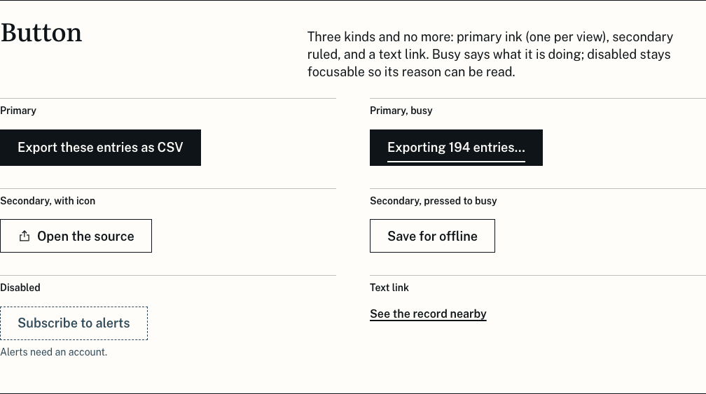

- **Purpose.** Primary (ink, one per view), secondary (ruled), text (underlined link).
- **Props.** `variant`, `children`, `icon?`, `href?` (renders a link; `external`), `onClick?`, `disabled?`
  (stays focusable, `aria-disabled`), `busy?` and `busyLabel` (worded, an ink line draws under it), `full?`.
  Every `aria-*` and `data-*` prop (test ids, tour anchors) passes through to the element.
- **States.** Default, hover (primary lightens to ink 2; secondary inverts; text thickens), focus, pressed,
  busy, disabled (dashed rule, reason beside it).
- **Accessibility.** Native button or link; busy sets `aria-busy`.

## PortFinder

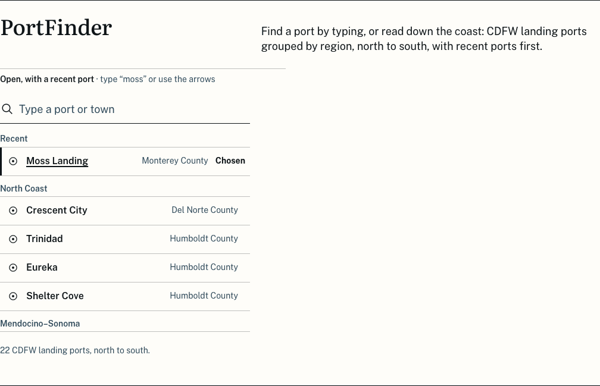

- **Purpose.** Find a port by typing (cmdk) or by reading down the coast, north to south, with recent
  ports first.
- **Props.** `ports: PortEntry[]`, `regions` (north-to-south order), `recent?`, `onSelect`, `current?`,
  `label?`, `autoFocus?`, `nameLayoutId?(port)` (a Motion `layoutId` for the chosen port's name, so it travels
  into the next view's title; return undefined for every other port).
- **States.** Open, with recent, filtered, no match (words that say what to try), current port marked.
- **Accessibility.** cmdk's combobox and listbox semantics; type, arrows, Enter; 48 px rows.

## Popover, Dialog, Tooltip

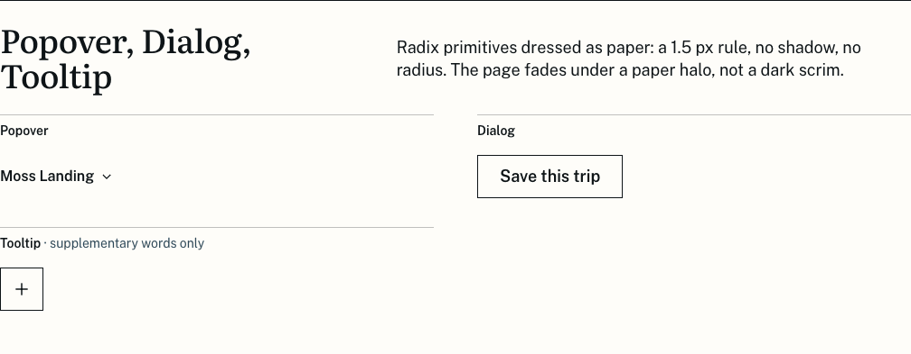

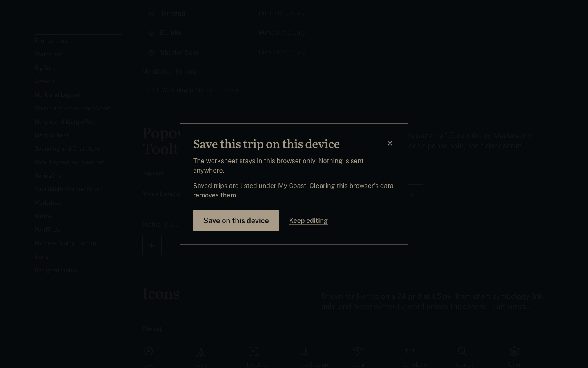

- **Purpose.** Radix primitives dressed as paper: 1.5 px ink rule, no shadow, no radius; the page fades
  under a paper halo, not a dark scrim.
- **Props.** `Dialog`: `title`, `description?`, `placement` `center | side`, `trigger?`, `open?`,
  `defaultOpen?`, `onOpenChange?`, `footer?`. `Popover`: `trigger`, `children`, `label?`, `side`, `align`.
  `Tooltip`: `content`, `children`, `side` (needs one `TooltipProvider`).
- **Motion.** Dialog and Popover enter with `register` (side sheets with `sheet`); Tooltip fades with
  `marginSwap`.
- **Accessibility.** Radix focus management; a tooltip only ever repeats words that exist elsewhere.

## Icons

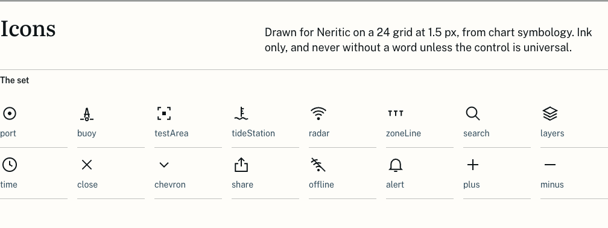

- **Purpose.** A custom set from chart symbology on a 24 grid at 1.5 px: port, buoy, test area, tide
  station, radar, zone line, search, layers, time, close, chevron, share, offline, alert, plus, minus.
- **Props.** `name`, `size`, `label?` (only for a universal control with no word), `direction` (chevron).
- **Rules.** Ink only (`currentColor`); decorative by default (`aria-hidden`).

## Designed states: Unavailable, Stale, Offline, SourcesDiffer, Loading

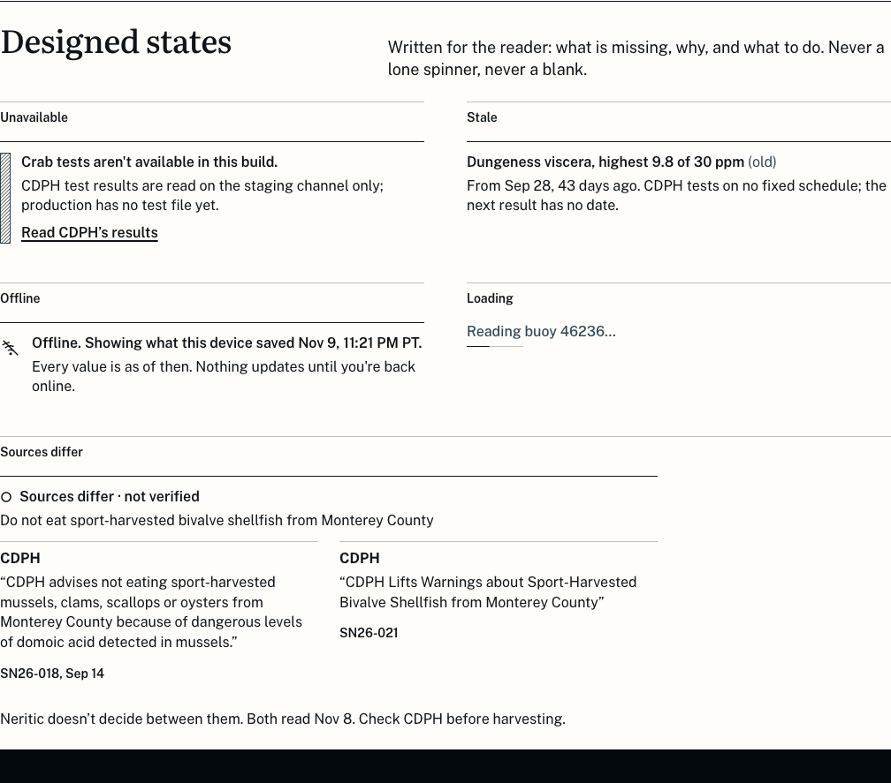

- **Purpose.** Each says what is missing, why, and what to do. Never a lone spinner, never a blank.
- **Props.** `Unavailable`: `what`, `why`, `next?`. `Stale`: `date`, `now`, `why`, `children`. `Offline`:
  `savedAt`, `now?`. `SourcesDiffer`: `subject`, `claims` (agency, quoted words, reference, url),
  `checked`, `next` (T40: Neritic never resolves the disagreement). `Loading`: `children` (what is being
  read).
- **Motion.** Loading inks a thin line under its words with `ink` (static under reduced motion).
- **Accessibility.** Offline and Loading are status regions; SourcesDiffer is named "Sources differ, not
  verified" and quotes each agency in a `blockquote` with its source.

---

## Not in this library

The persistent chart host (`Sheet`), `Neatline` and `TimeRail` are map-host specific and belong to the shell
owner. Sounding, ChartNote and Readout are presentational so the host can place them.
